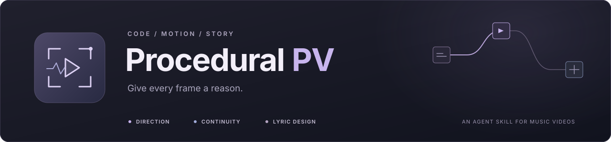
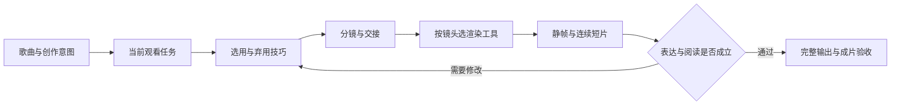

<div align="center">

<picture>
  <source media="(max-width: 640px)" srcset="docs/readme/hero-compact.svg" />
  
</picture>

<p>
<strong>让代码构成画面，让镜头讲述故事。</strong><br />
<sub>镜头设计 · 连贯转场 · 元素叙事 · 歌词融景 · 渲染验收</sub>
</p>

<p>
<a href="skills/procedural-pv/SKILL.md"></a>
<a href="SOURCES.md"></a>
<a href="#skill-各部分的作用"></a>
<a href="NOTICE.md"></a>
</p>

<p>
<a href="#安装与第一次使用"><strong>快速开始</strong></a> &nbsp;·&nbsp;
<a href="skills/procedural-pv/references/technique-selection.md">技巧选用</a> &nbsp;·&nbsp;
<a href="SOURCES.md">参考作品</a> &nbsp;·&nbsp;
<a href="docs/TOOLS.md">渲染工具</a> &nbsp;·&nbsp;
<a href="examples/shot-selection.md">分镜示例</a>
</p>


<br />
<sub>给起步的创作者一根拐杖，把故事与取舍留给你。 · <a href="https://github.com/swat22544">swat22544</a></sub>

</div>

<div align="center">
<table>
<tr>
<td align="center" valign="top" width="33%">
<strong>01 · 先选技巧</strong><br />
<sub>按观看任务决定取舍，<br />让画面有清楚的重点。</sub>
</td>
<td align="center" valign="top" width="33%">
<strong>02 · 编排叙事</strong><br />
<sub>镜头、元素与歌词彼此承接，<br />让动作留下可读的结果。</sub>
</td>
<td align="center" valign="top" width="33%">
<strong>03 · 渲染验收</strong><br />
<sub>按镜头需要选择工具，<br />复核时间、阅读与实际成片。</sub>
</td>
</tr>
</table>
</div>

<p align="center"><sub>4 部参考 PV · 2 份本地实践工程 · 22 篇参考说明 · 按需选用</sub></p>

---

## 先说清楚：这是一根拐杖，甚至是一根半成品拐杖

这个 skill 整理了几部相当优秀的代码 PV 中值得学习的设计，也收进了我们自己制作 PV 时积累的经验。做它的初衷很简单：降低初上手者创造精美画面的门槛。让一个还不熟悉运镜、转场、动态排版和渲染的人，有机会更快地做出一段看得下去、读得清楚、前后有所呼应的画面。

但我希望你先认识到，它是一根拐杖，甚至是一根半成品拐杖。它可以适当地拔高你的下限，代价则是：当你越来越依赖它给出的现成答案，它也会在一定程度上卡住你的上限。模型很容易从已经总结过的技巧里选方案，你也可能逐渐习惯让它替你判断。久而久之，每一段都能找到一种“合适的效果”，整支片子却越来越像同一套方法的排列组合。

在学习这些作品的过程中，我注意到，真正优秀的创作者会认真打磨每一个分镜、每一句歌词，甚至逐帧调整。一个物体为什么从这里出现，一次停顿要留多久，镜头此刻应该靠近还是远离，上一幕留下的东西该怎样进入下一幕，都有具体的考虑。好看的运镜和转场背后，是对观众此刻在看什么、感受到什么，以及接下来应该理解什么的反复推敲。

这个 skill 能提供一些方法，帮助你的画面好看一些、连贯一些，也减少技术上的反复踩坑。PV 的画面表现固然重要，但它的内核、它想讲述的故事，才是最重要的。这个“故事”可以是一段关系的变化、一种情绪的积累，也可以是一组抽象形象随着音乐发生的转变。它需要属于这首歌，也需要属于你。

这一部分需要你一点点地学习、借鉴、积累，再变成自己的思路。看参考时继续追问：这个镜头为什么成立？换一首歌还成立吗？如果拿掉这个效果，表达会损失什么？如果技能的建议与你真正想表达的东西冲突，就回到音乐和画面本身，重新作决定。

我希望它能帮你走过最开始那段路，把一些精力从工具和流程里解放出来，留给故事、节奏和审片。也希望你在使用它的过程中，逐渐能够判断哪些规则值得保留，哪些规则应该改掉，以及什么时候已经不需要这根拐杖。

## 从哪里开始

- **先看能学到什么**：[四份 PV 参考](#四份-pv-参考分别贡献了什么)、[本地 PV 实践](#本地-pv-提供了哪些实践经验)。
- **准备使用**：[安装与第一次使用](#安装与第一次使用)、[渲染工具清单](docs/TOOLS.md)。
- **找具体方法**：[模块地图](#skill-各部分的作用)、[技巧选用与组合判断](skills/procedural-pv/references/technique-selection.md)。
- **了解来源与范围**：[研究版本与署名](SOURCES.md)、[公开版与本地版](docs/PORTABILITY.md)、[许可说明](NOTICE.md)。

本仓库提供 **1 个 skill、22 篇参考说明和 1 份示例分镜**。它通过指令与资料帮助 agent 设计、实现和验证 PV；渲染器、音乐、字体和原项目资产需要按自己的工程准备。

## 四份 PV 参考分别贡献了什么

四个项目的风格与实现并不相同。下面列的是这次研究中重点提取的方法，不是对作者作品的完整定义，也不是要求每支 PV 都各用一遍。

| 参考 | 重点学习什么 | 在自己的 PV 中怎么用 |
|---|---|---|
| [mexicat / pdoom-video](https://github.com/mexicat/pdoom-video) | **镜头设计、观看角度、空间揭示和文字的材料感。** 区分相机位置、注视点、焦距与滚转；研究跟拍何时开始、何时释放，以及运动后的阅读落点。 | 先说明“这个机位让观众多看懂了什么”，再选择推进、斜视、低机位、拉远或定镜。借用导演方法时不必继承橙黑纸色和线描外观。 |
| [FrostNovaOrg / world-execute-web](https://github.com/FrostNovaOrg/world-execute-web) | **转场前后的状态一致与连续世界。** 相邻镜头共享时间、几何、相位或屏幕锚点；相机、场景、文字各自安排交接窗口。另保留语义/计算机制的研究。 | 让下一镜接住上一镜真正留下的状态；区分位置相接、速度相接和有意切换。没有承接依据时，清楚的硬切也可以成立。 |
| [MisakaZentai / world-execute-me-dsh-pv](https://github.com/MisakaZentai/world-execute-me-dsh-pv) | **元素动作的因果与持续叙事。** 来源→载体→到达→留下结果→触发下一动作；分析双画面主次、绘制责任、界面剥离、记忆与复现。 | 让运动改变后镜的状态，让观众看得见“前一个动作造成了什么”。区分同一对象、共享几何、形态匹配与语义呼应，避免把任意粒子飞行都称为接力。 |
| [Nyankomintsu / world-execute-me-lyric-mv](https://github.com/Nyankomintsu/world-execute-me-lyric-mv) | **文字身份、歌词叙事与画面语言切换。** 字体区分发言者，歌词参与消息、内心插镜、执行、删除与复唱状态；聊天、版画、代码画面共用叙事时间。 | 让字幕成为发言、材料或操作，必要时由一句话承担完整分镜。保持自己的主题语言，不必复制聊天框、角色剪影或版画配色。 |

pdoom 的空间/材料文字与 Nyanko 的发言/主观文字一起进入了歌词模块；FrostNova 和 Misaka 的旧研究也继续保留，没有被后加入的参考替换。源码定位、固定提交、证据边界和各自许可见 [SOURCES.md](SOURCES.md)。

另保留了 [onetake](https://github.com/feitangyuan/onetake) 的连续动效方法笔记，作为动作与连续性辅助资料。它属于额外的方法来源，不计入上面的四部 PV。

## 本地 PV 提供了哪些实践经验

这些是我们自己的制作案例，用于说明方法如何落到工程里。它们与四份外部参考的来源分开记录；公开 skill 没有附带原曲、原歌词、参考影片或两个完整本地工程。

| 实践项目 | 实际使用的主路线 | 留下的经验与边界 |
|---|---|---|
| **world.execute(me) · V14 原生 4K** | NumPy / Pillow 的程序画面与文字，FFmpeg 分段编码；3840×2160、24 fps | 双主体身份、语义动作、跨段几何、歌曲钟与片头偏移分离、原生高分辨率排版。区分 720p 局部重绘发布与完整重新计算的 4K 派生；自动逐词时序仍需人工听校。 |
| **Machine Love · V2** | Python / NumPy 状态层、ModernGL 舞台、Pillow 字幕、FFmpeg；3840×2160、24 fps | 把状态计算、GPU 绘制和文字合成分开；复唱更新歌词而不重置已经成熟的视觉形态。多模型声学对齐保留分歧和插值标记。使用了装有 Manim 的 Python 环境，画面主体并非 Manim Scene。 |
| **《把回声点亮 / ECHO, RETURNED》· 应用样片** | Multiplane + Canvas 自定义透视，原创编排音乐与歌词；40 秒、1920×1080、60 fps | 将机位、路线→折痕→翅膀的元素接续、文字载体和停顿放在同一短片中试用。后来移除了合成人声，保留器乐与画面。这个样片没有使用 Blender 或 Three.js。 |

前两个工程是长期制作经验来源，第三个是研究更新后的应用样片。项目细节与已验证范围见 [本地实践说明](docs/LOCAL_PROJECTS.md)；这里的规格是案例事实，不是对新作品的固定要求。

## skill 各部分的作用

agent 先读入口和选用规则，再按当前任务读取专项。目录不是一张“所有效果都要用”的待办单。

| 部分 | 文件 | 作用 |
|---|---|---|
| 入口与调用 | [SKILL.md](skills/procedural-pv/SKILL.md)、[openai.yaml](skills/procedural-pv/agents/openai.yaml) | 定义适用任务、先导演后实现的次序、资料路由与交付要求；宿主元数据用于发现与调用。 |
| 技巧判断 | [technique-selection.md](skills/procedural-pv/references/technique-selection.md) | 根据观看任务、阅读负担和情绪选择方法，写明采用/弃用理由，处理注意力冲突。 |
| pdoom 镜头 | [设计方法](skills/procedural-pv/references/pdoom-design.md)、[制作细则](skills/procedural-pv/references/pdoom-camera-method.md)、[逐场案例](skills/procedural-pv/references/pdoom-shot-cases.md) | 从观察任务推导景别、角度、相机参数、追踪/释放、阅读停顿与空间转场。 |
| 连贯转场 | [FrostNova 转场](skills/procedural-pv/references/frostnova-transitions.md)、[连续镜头](skills/procedural-pv/references/onetake-continuity.md) | 在分镜阶段约定时间、对象、相位、投影、速度与交接责任，区别连续与有意断开。 |
| 元素叙事 | [Misaka 方法](skills/procedural-pv/references/misaka-motion-method.md)、[逐链案例](skills/procedural-pv/references/misaka-motion-cases.md) | 把动作写成可读的因果链，检查最后一个载体的到达、接收后的持久状态与下游动作。 |
| 歌词融景 | [歌词方法](skills/procedural-pv/references/lyric-dramaturgy.md)、[pdoom 文字案例](skills/procedural-pv/references/pdoom-lyric-cases.md)、[Nyanko 文字案例](skills/procedural-pv/references/nyanko-lyric-cases.md) | 明确声音身份、文字载体、叙事动作、可见后果与完整读窗；容许文字独镜和稳定字幕。 |
| 视觉机制 | [visual-techniques.md](skills/procedural-pv/references/visual-techniques.md) | 保留语义几何、计算机制、音频驱动和后期研究，标明真实计算、示意数据与艺术隐喻。 |
| 制作与输出 | [production-workflow.md](skills/procedural-pv/references/production-workflow.md)、[rendering-techniques.md](skills/procedural-pv/references/rendering-techniques.md) | 音轨与词时序、确定性状态、字体布局、高分辨率、时间采样、分段输出与成片验收。 |
| 工具与环境 | [local-tools.md](skills/procedural-pv/references/local-tools.md)、[environment-setup.md](skills/procedural-pv/references/environment-setup.md)、[blender-workflow.md](skills/procedural-pv/references/blender-workflow.md) | 按镜头选工具，解析本机路径；区分 Blender/MCP/原生渲染，保留环境检查与旧验证边界。 |
| 来源与保留 | [source-study.md](skills/procedural-pv/references/source-study.md)、[legacy-sources.md](skills/procedural-pv/references/legacy-sources.md) | 六份工程的来源地图与研究范围，防止新增参考时丢失旧方法或混淆来源。 |
| 本地案例 | [project-defaults.md](skills/procedural-pv/references/project-defaults.md)、[world-execute-workflow.md](skills/procedural-pv/references/world-execute-workflow.md)、[machine-love.md](skills/procedural-pv/references/machine-love.md) | 保存旧片的具体决策、版本差异与制作经验；只在研究案例或确实继续原工程时使用。 |

## 如何避免把四种风格全部堆上去

skill 有独立的 **技巧选用与组合判断** 层。先决定这段让人读懂什么、看见什么或感受到什么，再挑方法。美术材料、对象身份和节奏属于本片；参考中的配色、终端、聊天窗、粒子和故障效果按需采用。



| 情况 | 优先考虑 | 不强行加入 |
|---|---|---|
| 一句长歌词，情绪需要等待 | 稳定构图、完整读窗、轻微环境变化 | 环绕相机、强形变和同步爆发的后期 |
| 视角变化确实能揭示结构关系 | 有目的的推进、斜视、跟拍或拉远 | 为了“高级”让平面内容一直转圈 |
| 两镜共享对象或状态 | 有对应关系的交接、投影和速度检查 | 仅靠同色粒子声称主体连续 |
| 音乐发生突变，场景关系断开 | 有音乐落点和定位线索的硬切 | 给无关场景编造一条连续路径 |
| 文字本身就是发言或操作 | 字体身份、执行/删除/回执及其后果 | 每一句都变成聊天窗口 |
| 高密度高潮或有意混合风格 | 保留密度，组织主次与章节识别线索 | 把“少用效果”当成一条普遍审美定律 |

相机、文字、主体和后期可以同时工作，前提是服务同一意图，并有清楚的时间安排。检查时会做删减比较：拿掉某层后，情绪、理解、节奏和承接有没有损失？没有贡献的效果就删掉、错开或减弱。具体例子见 [示例分镜](examples/shot-selection.md)。

## 能带来的实际优势

1. **更容易把审美要求变成可执行分镜。** “更有镜头感”可以拆成观察任务、起终构图、追踪对象和落点；模型有具体约束，创作者也更容易指出哪里需要改。
2. **更早处理连续性问题。** 在实现前就约定交出的状态与接收结果，减少到最后才用淡化、模糊遮住跳变的返工。
3. **让歌词参与画面，同时保住可读性。** 字幕可以承担空间、身份与叙事动作；长句和复杂镜头也有稳定阅读层这条退路。
4. **跨工具制作更清楚。** 网页、Python GPU、Blender 与原生工程各做适合的镜头，用统一时间、帧区间、色彩和合成契约衔接。
5. **更容易复现和修改。** 绝对时间、固定随机种子、输入签名、分段输出与实际媒体检查，有助于减少预览/成片差异和无效续渲。
6. **保留创作者的取舍空间。** 技巧有适用条件，也有放弃信号；局部换字、换音轨时沿原方案处理，不把小改动扩大成重新设计整片。

这些优势来自明确的方法与工程约束，没有做过普遍的质量、速度或成本对照实验，不承诺“一键达到参考片水平”。分镜与歌词的逐帧打磨仍然是作品质量的重要来源。

## 需要哪些渲染工具

**最小网页路线**：能读取 skill 并执行本地工具的 agent + Multiplane + 其匹配的 Chromium + FFmpeg/FFprobe + 本片所需字体与音频。命令行安装 Multiplane 需要 Node.js 24+；官方桌面发行包可自带 Node 运行时，FFmpeg 仍单独准备。[Multiplane 官方说明](https://github.com/LBEILC/Multiplane)

| 工具 / 路线 | 何时需要 | 在成片中负责什么 |
|---|---|---|
| **FFmpeg / FFprobe** | 实际成片交付的基础工具 | 编码、拼接、混音、换轨、尺寸/FPS/帧数/音轨/完整解码检查 |
| **Multiplane + Chromium** | 默认网页/动态文字/2.5D 路线 | 按 `render(t)` 逐帧导出，静帧、确定性检查、续渲与时间采样 |
| **NumPy + Pillow，按需 ModernGL** | 数学几何、离线像素与 GPU 点线 | 状态计算、几何舞台、清晰字形与图层合成 |
| **Three.js / WebGL** | 网页镜头需要真正的三维结构与 GPU 场景 | 相机、几何、实例化和着色器；通过 Multiplane 或有效专用导出链输出 |
| **Blender + bpy + EEVEE/Cycles** | 实体遮挡、材质、灯光、复杂三维镜头 | 程序建场景与原生 PNG/EXR 等序列渲染 |
| **MCP for Blender** | 需要 agent 操作和查看正在运行的 Blender | 查询场景、代码编辑、视口与结果回读；是可选控制接口 |
| **Manim / MathTypst** | 需要公式推导或数学变换镜头 | 输出独立动画或数学图形素材 |
| **After Effects / JSX / aerender** | 继续已有 AE 工程或原生后效 | 原生合成与输出；软件及可用环境自行准备 |
| **stable-ts / faster-whisper / MMS_FA / Demucs** | 需要辅助歌词对齐或分析分轨 | 提供候选时序、分析轨与特征；最终仍需听校 |

不用为了安装这个 skill 而装齐所有工具。没有固定显卡型号要求；选择 GPU 路线时再检查上下文、驱动、显存与实际速度。VOCALOID、人声合成、付费素材服务和辅助模型都不属于必需依赖。完整安装入口、配置要点和验收步骤见 [docs/TOOLS.md](docs/TOOLS.md)。

## 安装与第一次使用

仓库中的可安装目录是 `skills/procedural-pv/`，需要把整个目录一起安装，不能只复制 `SKILL.md`。

**Codex 本地安装：** 克隆或下载本仓库，将该目录放到用户技能目录 `~/.agents/skills/procedural-pv/`，或当前项目的 `.agents/skills/procedural-pv/`。若已有同名技能，先比较并备份自己的修改，避免同时保留两份冲突的定义。技能位置与发现规则以 [OpenAI 官方文档](https://learn.chatgpt.com/docs/build-skills) 为准；未显示时重新打开会话。

```text
你的技能目录/
└── procedural-pv/
    ├── SKILL.md
    ├── agents/openai.yaml
    └── references/...
```

其他支持 Agent Skills 的工具按其技能目录规则安装；无法自动加载时，也可以把入口和需要的参考交给 agent 阅读。当前实践以本地 Windows 制作为主，不把资料可读取等同于所有宿主与操作系统已经完整验证。

可以这样开始：

> 使用 $procedural-pv，为我提供的音乐做一段 20 秒样片。主题是“等待一封不会到来的回信”，视觉偏克制。先明确各镜头的观看任务，说明采用与放弃的技巧，再做静帧和连续短片。歌词可以原创；长句要完整读清。优先用网页路线，素材与输出放在独立工程中。

开始实际制作前，让 agent 读取 [环境接入](skills/procedural-pv/references/environment-setup.md) 并确认程序入口、音轨、字体和输出路径。缺少渲染器时先完成能做的设计工作，再明确缺项；skill 不会凭空使本机具备未安装的工具。

## 研究范围、维护与署名

本 skill 由维护者提出方向、选择参考、审片和决定取舍，Codex 参与源码分析、制作实践和文档整理；包含 AI 辅助内容。四份参考的作品、代码与素材归各自作者，感谢他们公开制作过程。

研究记录区分了源码阅读、有限函数检查、抽帧/连续窗口观察、本地成片检查与尚未覆盖的部分。没有把四部原片全部重新渲染，也不把作者的性能数据写成本机实测。新版维护应保留来源提交、适用条件、反例和检查边界，继续补充经过验证的方法。

原创整理文字与自有示例按 [MIT License](LICENSE) 发布；第三方代码、素材、音乐、歌词、字体与商标保留各自权利，详见 [NOTICE.md](NOTICE.md) 和 [SOURCES.md](SOURCES.md)。学习方法不代表可以重新许可原作品，也不代表原作者为本 skill 背书。
